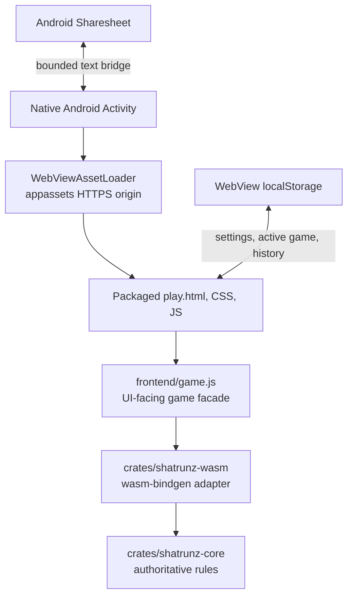

# Android MVP architecture and source map

## Runtime shape

Android loads `assets/www/play.html?mode=hvh&platform=android` by default. The mode links reload that packaged page with `mode=hvh`, `mode=hvc`, or `mode=cvc`; the existing PvP/PvAI/AIvAI controllers then run against the same rules. Android removes the service-backed C Engine strategy from AIvAI, leaving the local JavaScript strategies available offline. CSS moves the board first on narrow screens. `wasm_boot.js` resolves the generated WASM JavaScript relative to its own URL, which works under the appassets origin as well as the website root.

The Gradle `syncWebAssets` task depends on `buildShatrunzWasm`, then copies the frontend to `android/app/src/main/assets/www`. `frontend/pkg` remains generated and Git-ignored. The Rust toolchain and Android SDK are required for a clean build.

## Android trust boundary

- `WebViewAssetLoader` hosts app assets at `https://appassets.androidplatform.net/assets/...` so normal same-origin module/WASM loading works.
- The Activity admits only `play.html` as a main-frame page, allows only appassets subresources, and blocks other requests/navigation.
- JavaScript and DOM storage are enabled because the existing game uses them; file/content access and mixed content are disabled. There is no `INTERNET` permission.
- The only JavaScript bridge operation shares bounded plain text using an Android chooser. Keep it narrow and available only to trusted packaged code.
- No external iframe, remote script, dynamic HTML source, engine download, or untrusted game content should be allowed to call the bridge.
- `allowBackup=false` is the current prototype choice. Revisit backup/migration expectations before release.

## Game and persistence boundaries

- Rust core validates and applies moves. JavaScript requests/display/legal-highlights must not become another authority.
- `GameSession` records UCI-style history and asks `PGNManager` to persist an active game per mode. The v1 saved envelope carries schema version, mode, UCI history, local PGN-like game record, timestamp, and autoplay state.
- On restore, each move is replayed through the normal game facade; malformed, too-large, unsupported, or illegal save data is discarded instead of assigned directly to a board.
- Completed games remain in the existing local 50-game history. New Game prompts before discarding an unfinished game. A completed result clears the active-game save.
- Current save storage is WebView `localStorage`. It has no migration UI, cloud sync, cross-device transfer, or strong filesystem durability guarantees. Add a versioned native repository before promising those behaviors.
- Existing custom `UciMoves` supports project replay, but standard PGN/FEN losslessness for 9×9 ShatrunZ is not established. Keep export labels/metadata honest.

## Source keep/adapt/defer

| Source path | Owner / role | Android handling |
| --- | --- | --- |
| `docs/rules.md` | Normative variant definition | Preserve and update before rule behavior changes. |
| `crates/shatrunz-core/` | Rust domain and AI | Preserve as authoritative; no Android imports. |
| `crates/shatrunz-wasm/` | Browser boundary | Build for `wasm32-unknown-unknown`; use only in packaged web UI for MVP. |
| `frontend/game.js` and `frontend/shared/` | JS facade/session/settings/replay | Reuse; maintain replay/localStorage and browser behavior. |
| `frontend/play.html`, `frontend/main.js`, `frontend/ui.js`, `frontend/style.css` | Existing game presentation | Adapt route query, small Android feature hooks, board-first narrow layout. Do not port wholesale into Java. |
| `frontend/modes/pvp.js`, `frontend/modes/pvai.js`, `frontend/modes/aivai.js` | Existing local mode controllers | Reuse; AIvAI uses local JS strategies. |
| C engine/API, `backend/`, `/admin`, ML service | Existing optional/network/server workflows | Exclude from offline Android MVP; evaluate later behind explicit interfaces. |
| `.mcp.json`, `crates/shatrunz-mcp` | Local agent/developer tools | Leave out of Android package; no duplicate server. |
| DroidFish | External UX/feature reference | Do not copy code/assets. License review before any reuse. |

## Future native UI path

If Android/iOS native UI becomes a priority, first define a stable Rust-facing data contract that can construct/replay a game, inspect state/legal actions, apply/undo moves, return result/events, and encode/decode saves. Build a JNI or UniFFI adapter only after measuring the requirements; share the Rust kernel rather than translating rules into Kotlin/Swift. Differentially compare WASM and FFI bindings on the same fixtures. Keep each platform's UI and lifecycle code native where that improves the player experience.
